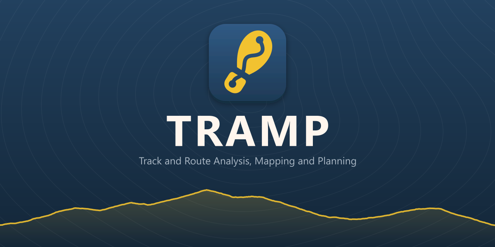
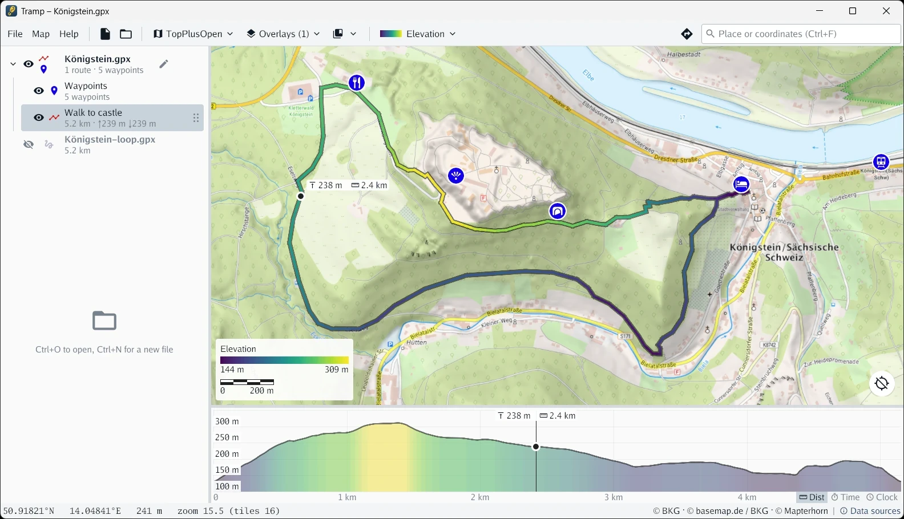

<div align="center" width="100%">
<a href="https://github.com/mlange-42/tramp">

</a>
</div>

TRAMP is a fast, free desktop app for exploring your GPS tracks and planning the next tour,
on open maps from all over the web. No account, no cloud, no ads.
Written in [Go](https://go.dev), for Linux, Windows and macOS.

[](https://github.com/mlange-42/tramp/actions/workflows/tests.yml)
[](https://codecov.io/gh/mlange-42/tramp)
[](https://github.com/mlange-42/tramp)
[](https://github.com/mlange-42/tramp/blob/main/LICENSE)

> **Status:** Feature-rich and in daily use by its author, but still under development.
> Expect rough edges, and settings files that may still change.

## Features

- **Any map you like:** OpenStreetMap, topo and satellite maps with overlays for hillshading, hiking or cycling routes.
- **Explore your GPS tracks:** Color by speed, elevation or slope, with an interactive profile chart linked to the map.
- **Plan and edit:** Draw routes and waypoints by hand, or let routing do it for you.
- **Search and routing:** Find places and get routes on foot, by bike or car, with alternatives and elevation profiles.
- **Ready for your device:** Save routes as GPX with turn points, or as full tracks with elevations.
- **Weather on the map:** Rain radar, warnings and forecasts from DWD, with a time slider.
- **Live position:** From USB, Bluetooth or network GPS receivers.
- **Works offline:** Viewed map and elevation tiles are cached on disk.

Coming next: FIT and KML/KMZ files.

<div align="center" width="100%">

<br/>
<i>Planning a walk to Königstein Fortress in Saxon Switzerland, colored by elevation, with the linked profile chart.</i>
</div>

## Installation

### Precompiled binary

Binaries for Windows, Linux and macOS are available on the GitHub [releases page](https://github.com/mlange-42/tramp/releases).

### With Go

```sh
go install github.com/mlange-42/tramp@latest
```

TRAMP uses [Gio](https://gioui.org) for its GUI.
On Linux and macOS, this requires a C compiler.
On Linux, also the development headers listed in the [Gio Linux install docs](https://gioui.org/doc/install/linux) are required.

On Windows, add `-ldflags="-H windowsgui"` to prevent a console window from opening.

### Requirements

On Linux, the file dialog requires `zenity`, `kdialog` or a similar tool, which most desktops have installed.

## Documentation

- [Usage](docs/usage.md): map, search, opening files, coloring tracks, live GPS position
- [Editing](docs/editing.md): creating and editing routes and waypoints
- [Configuration](docs/configuration.md): settings, maps and color gradients

## Development

TRAMP is designed and maintained by [@mlange-42](https://github.com/mlange-42).
Most of the implementation was written with [Claude Code](https://claude.com/claude-code)
(Anthropic) as a pair-programming assistant.

Architecture, feature design, and technology choices are mine;
every change is reviewed, tested against real-world data,
and merged by me via pull request.

## Contact

For questions about TRAMP, and for operators of the map, search and routing services it uses:
[tramp@mlange.dev](mailto:tramp@mlange.dev)

## License

TRAMP and all its sources and documentation are distributed under the [MIT license](https://github.com/mlange-42/tramp/blob/main/LICENSE).

The waypoint symbol icons are from [Maki](https://github.com/mapbox/maki), released under [CC0](internal/symbols/maki/LICENSE.txt).
